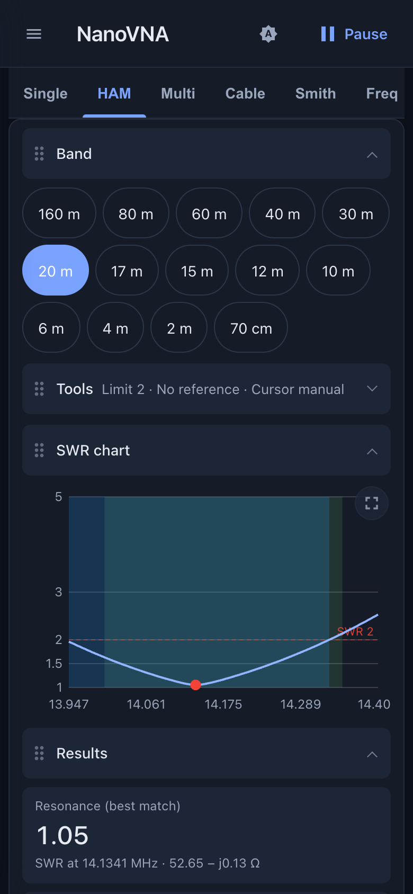
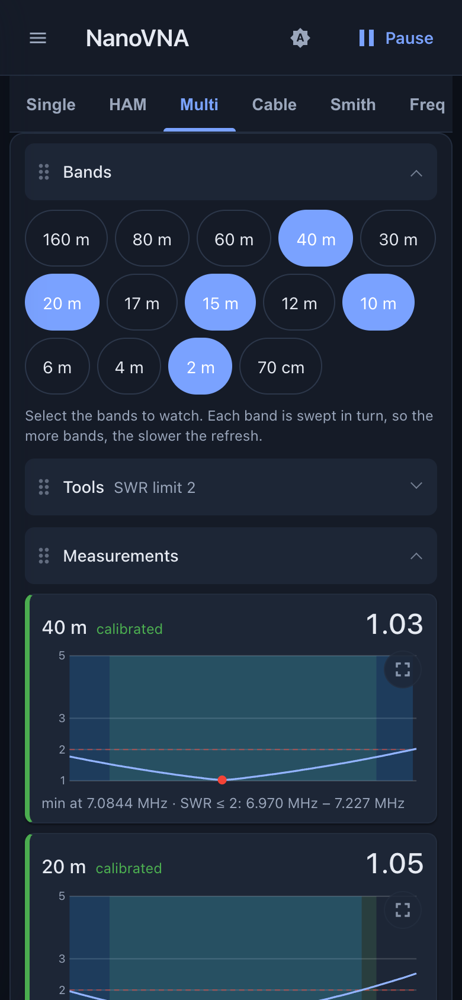
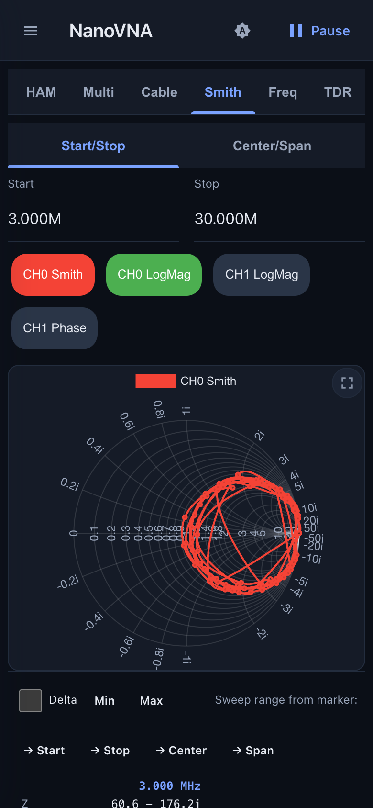
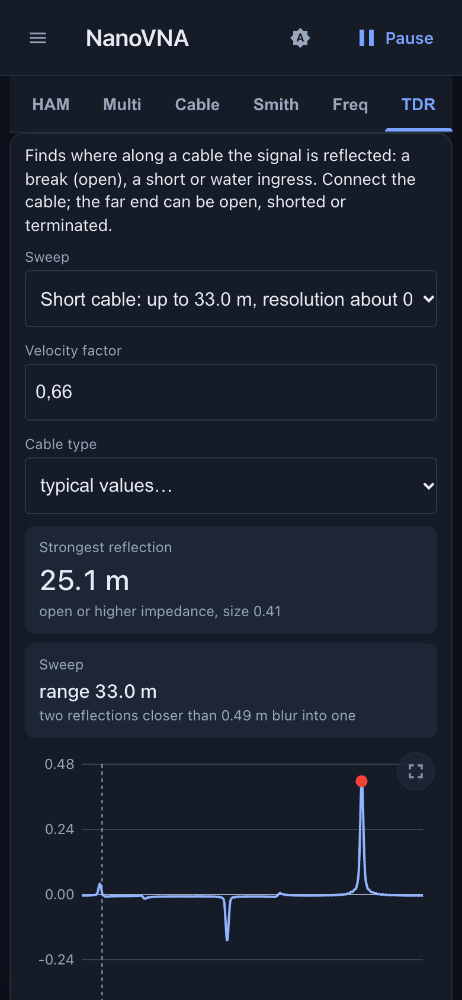
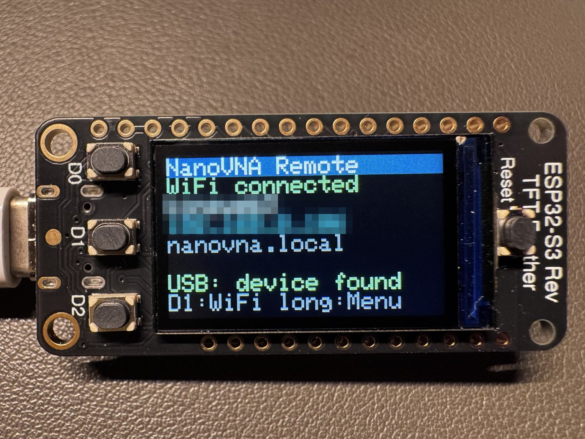
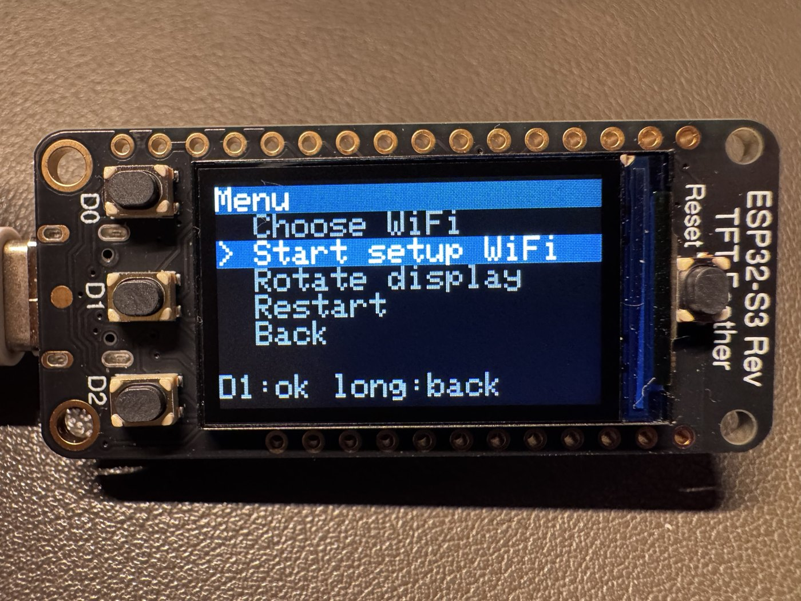

# NanoVNA Remote

**Measure antennas and cables with a NanoVNA from any phone or computer on your WiFi, right at the antenna.**

A small ESP32 board sits next to your NanoVNA-H, joins your WiFi and serves a measurement app. Open its address in a
browser: SWR, impedance, Smith chart, ham bands, cables and fault finding, with nothing to install on the phone.

<p align="center">
  
  
  
  
</p>

<p align="center"><sub>The screenshots show simulated values, not real measurements.</sub></p>

**Try it now, no hardware needed: [live demo](https://ckonecny.github.io/nanovna-remote/demo/)** (the real app with a simulated NanoVNA).
More pictures and a short tour: **[feature page](https://ckonecny.github.io/nanovna-remote/)**. Everything in detail:
**[manual (English)](manual/manual_en.md)** · **[Handbuch (Deutsch)](manual/manual_de.md)**.

## What it does

- **Single frequency:** SWR, return loss, impedance (R + jX or |Z| and angle), |Γ| and phase at one frequency, with a **log over time**
  (start/stop, your interval, eight formats, CSV export, kept in the browser).
- **Ham bands (HAM):** sweep a band, see the SWR curve with a limit line (1.5, 2 or 3), the minimum, the bandwidth around the resonance,
  plus return loss and R / X charts, and a saved reference sweep per band to compare before and after an adjustment.
- **Multi:** compare several bands side by side, each swept in turn. HAM and Multi have foldable sections you can move.
- **Calibration once for all bands:** open, short and load, each connected once. The app corrects all 14 ham bands from
  160 m to 70 cm, the result is stored in the device and every browser uses it.
- **Cables:** length, velocity factor, loss and characteristic impedance of a coax cable, stub lengths.
- **TDR:** shows where along a cable the signal is reflected (break, short, water).
- **Smith and Freq:** your own sweep as a Smith chart or as curves, with markers, scales and several traces.
- **Export:** Touchstone `.s1p` / `.s2p` files and PNG pictures of the charts.
- **Phone first:** dark and light theme, a layout that follows the screen size, works on desktop too.
- **Device display and buttons:** the Feather shows the WiFi (and whether a browser is connected), the address and the USB state; three buttons choose the
  network. Up to eight WiFi networks can be stored (home, hotspot, ...), with a setup WiFi as fallback.
- **Updates over WiFi**, no cable needed after the first flash.

## How it works

```
 NanoVNA-H --USB-- ESP32-S3 Feather --WiFi-- browser (all the evaluation happens here)
```

<p align="center">
  
  
</p>

<p align="center"><sub>The Feather's display: status screen (network name and address blurred) and menu.</sub></p>

The Feather is the USB host for the NanoVNA and passes its text commands through unchanged (WebSocket to USB serial). It
also serves the web app and keeps the calibration in flash. Everything else, the measurement maths, the charts, the
calibration, runs in the browser.

## What you need

- A **NanoVNA-H** (the text shell over USB; other NanoVNA models may work but are untested)
- An **Adafruit ESP32-S3 Reverse TFT Feather**, [product 5691](https://www.adafruit.com/product/5691)
- A **USB-C cable** between the two (the Feather is the host)
- Optional: a printed [case](enclosure/README.md) for the Feather
- Power for the Feather (USB-C power or a LiPo battery) and the **calibration kit** (open, short, load) that came with the NanoVNA
- To flash the ready-made release: Python with `pip install esptool`. To build it yourself: [Node.js](https://nodejs.org/) and [PlatformIO](https://platformio.org/)

## Quick start

1. **Flash the firmware** (it has the web app inside). Easiest, from the browser (Chrome or Edge): open the
   **[installer](https://ckonecny.github.io/nanovna-remote/install/)**, put the Feather in the bootloader (hold **D0**, tap
   **RESET**, release D0), click Connect, pick the port and choose Install. Or with a tool: download `nanovna-remote-<version>-first-flash.bin` from the
   [latest release](https://github.com/ckonecny/nanovna-remote/releases/latest), connect the Feather over USB-C to the computer,
   hold **D0**, tap **RESET**, release D0, and run (needs Python):
   ```sh
   pip install esptool
   esptool.py --chip esp32s3 write_flash 0x0 nanovna-remote-<version>-first-flash.bin
   ```
   Prefer to build it yourself? `cd client && npm install && npm run build:esp`, then
   `cd ../firmware && python3 -m platformio run -e feather -t upload` (needs Node.js and PlatformIO).
2. **Set up the WiFi.** On first start the Feather opens its own WiFi `NanoVNA-Remote` (password `nanovna-remote`) and
   shows a QR code for it. Scan it with the phone's camera and join; press D1 for a second code that opens the setup page (or open <http://192.168.4.1/wifi>).
   Scan for networks, pick yours, enter its password, save, press Connect.
3. **Connect the NanoVNA** to the Feather's USB-C port. The display says "USB: device found".
4. **Measure.** Open the address shown on the display (`http://<feather-ip>/`, also `http://nanovna.local/` where that
   works) on a phone or computer and tap **connect**.
5. **Calibrate once.** On the HAM tab press **Calibrate...** and follow the steps: attach the open, short and load standard
   in turn at the end of your cable and press **Measure** for each. Done for all bands.

Later updates go over WiFi: open `http://<feather-ip>/update` and pick the `-update.bin` of a release (or `curl --data-binary @nanovna-remote-<version>-update.bin http://<feather-ip>/api/ota`) or, when building yourself, `firmware/tools/ota.sh <feather-ip>`. Problems? See the troubleshooting chapter in the manual.

## Try it without hardware

The **[live demo](https://ckonecny.github.io/nanovna-remote/demo/)** runs the real web app in your browser against a
simulated NanoVNA: press connect, pick what is attached (antenna, open / short / load, cables) and try everything,
including the calibration. The values are modelled, not measured. The demo is built from the same code (`npm run build:demo`
in `client/`); `dev-tools/simulator.py` is the same simulation as a server, used for the screenshots. See
[dev-tools/](dev-tools/) and `docs/DECISIONS.md`.

## Project layout

- **firmware/** - ESP-IDF firmware (PlatformIO). Transparent WebSocket to USB-serial bridge, serves the web app,
  WiFi setup page, over-the-air updates, stores the calibration. See [firmware/README.md](firmware/README.md).
- **client/** - the web app (Vue 3, Vite). Based on cho45's
  [NanoVNA-Web-Client](https://github.com/cho45/NanoVNA-WebClient) and extended with the views, the app-side
  calibration and the cable tools above. See [client/README.md](client/README.md).
- **manual/** - user manual, English and German.
- **dev-tools/** - Python scripts for testing the bridge from a computer, the simulator and the screenshot script.
- **enclosure/** - 3D-printable two-part case for the Feather, in two variants (round or slotted button holes): STL, STEP, SolidCraft parts and the CadQuery source. See [enclosure/README.md](enclosure/README.md).
- **site/** - the feature page (GitHub Pages).
- **docs/** - project notes: [PROJECT.md](docs/PROJECT.md), [STATUS.md](docs/STATUS.md), [DECISIONS.md](docs/DECISIONS.md).
  Contributor notes for Claude sessions: `CLAUDE.md`.

## Contributing

Ideas, bug reports and feature requests are welcome as [GitHub issues](https://github.com/ckonecny/nanovna-remote/issues).

## Licenses

- `firmware/` is GPL-3.0-or-later.
- `client/` is GPL-2.0 (see `client/COPYING`, upstream cho45/NanoVNA-WebClient). It is built separately and only
  embedded into the firmware image as data, so both licenses stay apart.

- `enclosure/` (the case designs) is CC BY-SA 4.0, see `enclosure/LICENSE.md`.
- The QR code on the Feather's display is drawn with Nayuki's [QR Code generator](https://github.com/nayuki/QR-Code-generator) (MIT, `firmware/src/third_party/qrcodegen/`).
- The browser installer vendors [ESP Web Tools](https://github.com/esphome/esp-web-tools) (Apache-2.0, `site/install/vendor/`).

## Acknowledgements

This project was motivated by [akarpf/nanovna-tuner](https://github.com/akarpf/nanovna-tuner). The web app is based on
cho45's [NanoVNA-Web-Client](https://github.com/cho45/NanoVNA-WebClient).
