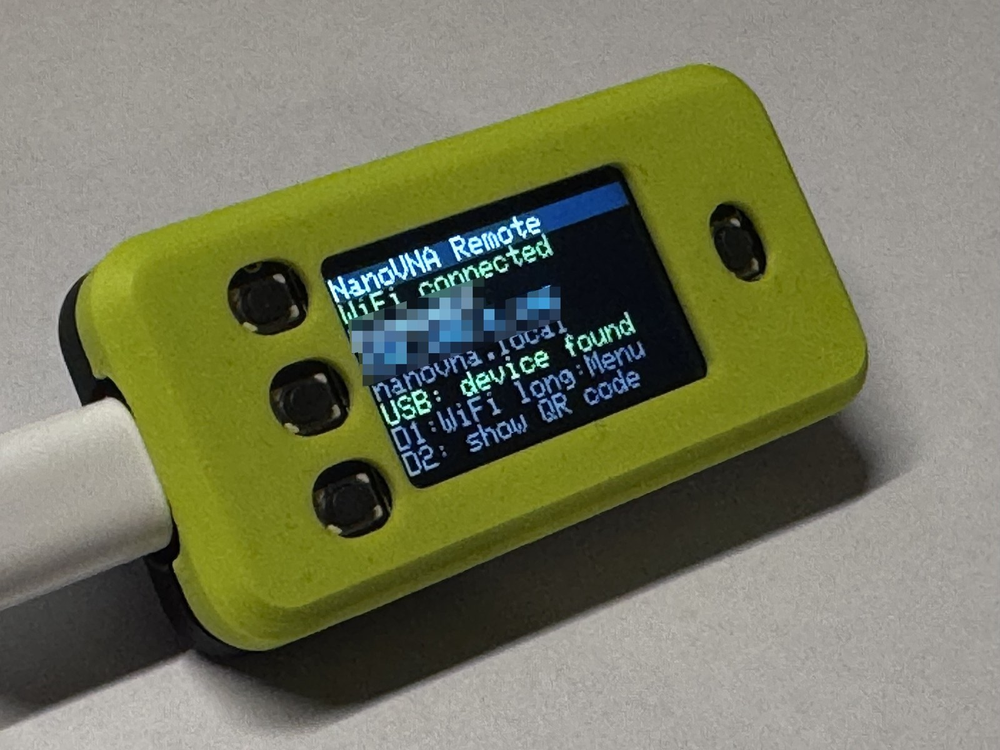
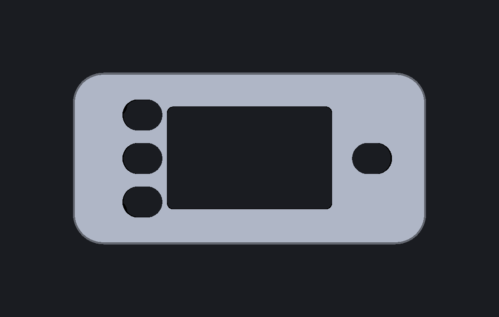
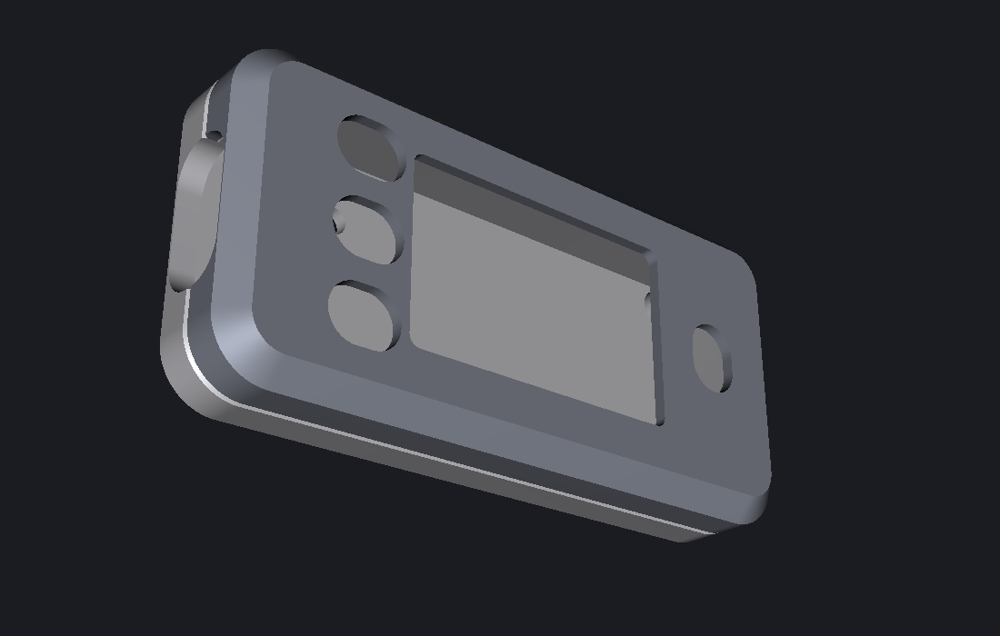

# Enclosure for the Feather

Two-part snap-fit case for the Adafruit ESP32-S3 Reverse TFT Feather (#5691), no screws, no battery.
The display and the four buttons are on the underside of the board, so the **front shell** has the display window
and the button holes, the **back shell** closes the top and carries the USB-C side.
Print it, put the Feather in, press the halves together.

## Design

The four button holes in the front shell are obround (slots), 6.4 mm long x 5.0 mm wide, following the pill-shaped caps;
the reset button hole is turned by 90 degrees, as that button sits rotated on the board.
Both shells have a 2 mm chamfer on the outer edge; the display window has no chamfer (the web between the buttons and the window is too thin for one).

The photo shows this version as printed, with the Feather running.

## Files

In this folder:

| File | Use |
|---|---|
| `feather_case_front.stl` / `.step` | front shell, in print orientation (window face on the bed) |
| `feather_case_back.stl` / `.step` | back shell, in print orientation (roof on the bed) |
| `feather_case_assembly.step` | closed case in board coordinates, for checking and for CAD |
| `feather_case.sc` | the same case as a native SolidCraft part (two bodies, `Front` and `Back`, closed case); named parameters (`gap`, `top_gap`, `wall`, `btn_d`, `btn_slot_w`, `edge_ch`, ...) and named features |

`make_enclosure.py` is the parametric source: change a number at the top, then run
`python make_enclosure.py`; it writes STL and STEP next to the script.
Requires `pip install cadquery`.

Outer size 56.8 x 27.7 x 11.1 mm (board 50.8 x 22.9 mm).

## Printing (Bambu Lab)
The case was printed successfully in PLA and PETG (the earlier versions without chamfers), 0.2 mm layers, no supports, no brim. Both shells print with the outer face on the bed (the 2 mm chamfer is a 45 degree slope there, which prints without supports). Walls 3 loops.
If the shells fit too tight or too loose, change `GAP` (sliding gap between lip and ring, now 0.15) and re-export.
The slot case without chamfers fit perfectly (fourth print); the version with the 2 mm chamfer is the fifth print. History and reasons: `docs/DECISIONS.md`.
Snap strength: `RIDGE_H` (ridge height) and `GROOVE_D`; the lid has to click, not slide off when lifted.

## Assembly
Lay the Feather into the front shell with the display down; the four 1.8 mm pins go through the mounting holes.
Press the back shell on until the ridges click into the grooves on the long sides. To open, put a screwdriver
into the notch on the end opposite the USB-C port. A paper clip through the small hole in the back reaches the
reset button on the top side; the display-side reset is one of the four front holes.

## Dimensions it is built on
Board outline and holes from Adafruit's EAGLE file, heights from Adafruit's STEP model (MIT licence, used for
measuring only and not stored here). Display front is 1.52 mm below the PCB, button caps 1.9 mm, the tallest part
(battery connector) 6.37 mm above the PCB top, USB-C 0.57 to 4.77 mm. Pass the STEP model to check the fit:
`python make_enclosure.py --board <path to 5691 STEP>` prints the overlap between board and both shells (0.000 now).

## Using it in SolidWorks and other CAD
STEP opens as a solid body without a feature tree (clean planes and cylinders, so FeatureWorks can recognise
holes and pockets). For real parametric edits use the `.sc` file or the numbers in `make_enclosure.py`.

## Limits
- No headers: with soldered headers the back shell is too shallow; raise `TOP_GAP` (it sets the roof height).
- The STEMMA QT and battery connectors are not reachable (not needed here).
- The USB-C opening is a 12.4 x 6.8 mm rounded rectangle, sized for a normal plug moulding.

## Licence
Creative Commons Attribution-ShareAlike 4.0 International (CC BY-SA 4.0), see [LICENSE.md](LICENSE.md).
This is separate from the firmware (GPL-3.0-or-later) and the web app (GPL-2.0).
