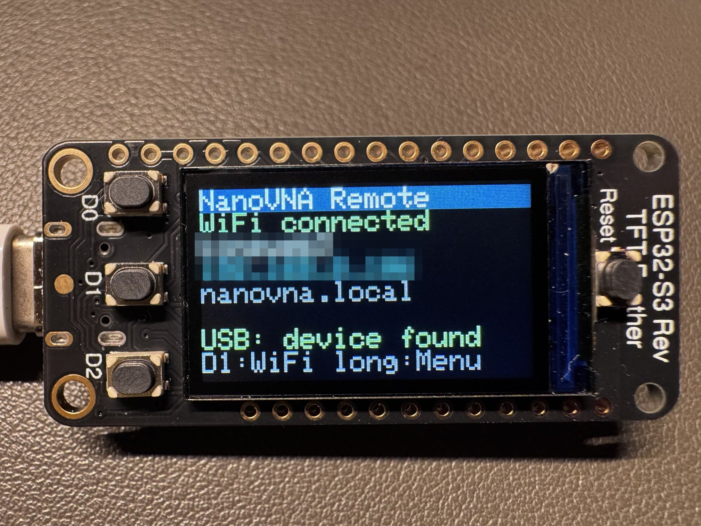
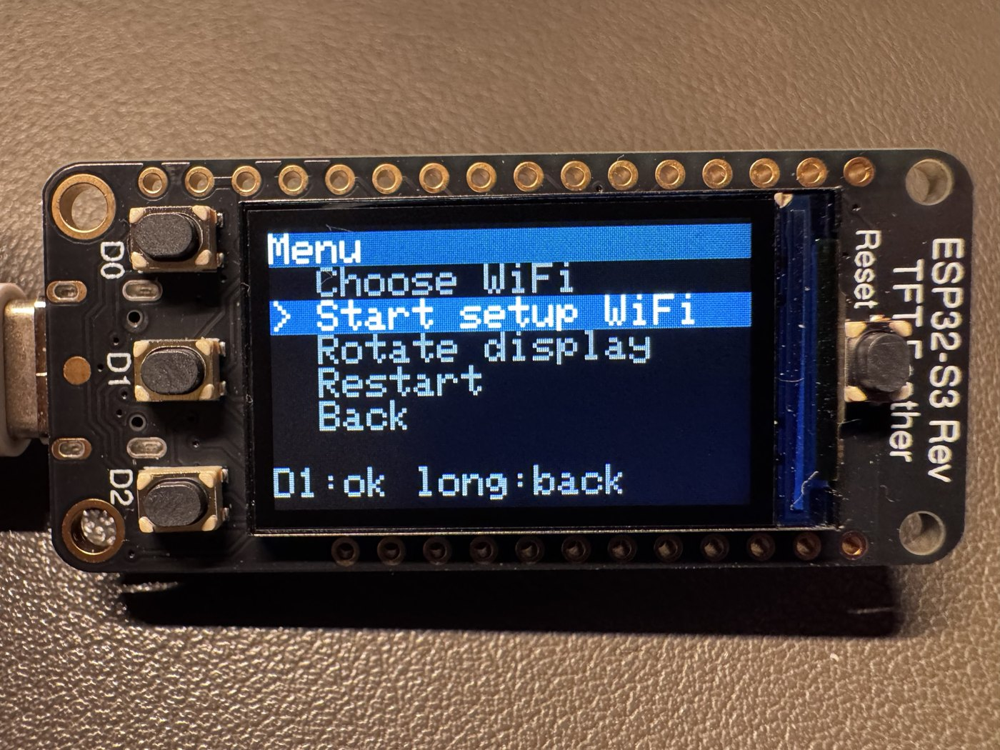
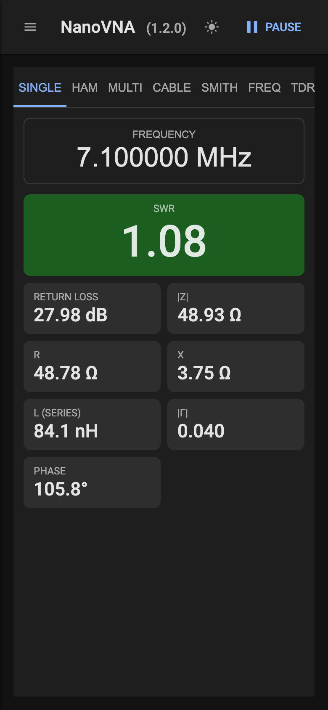
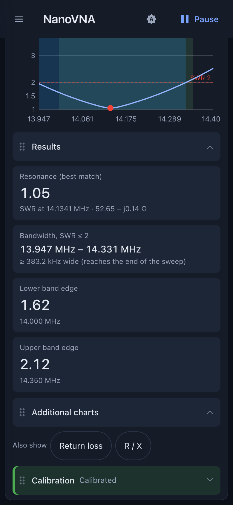
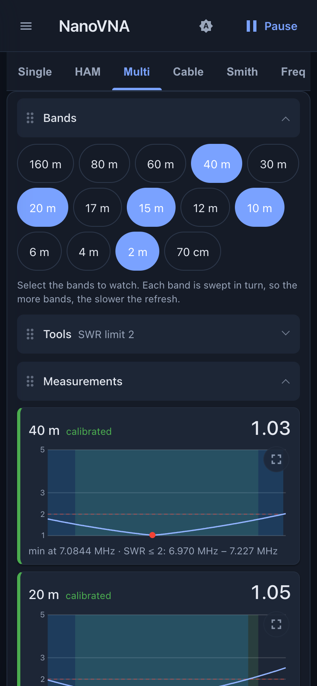
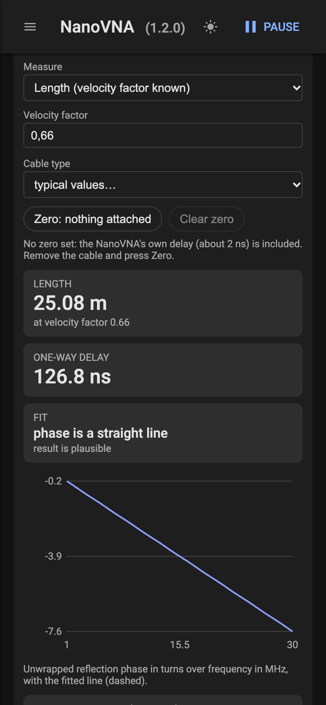
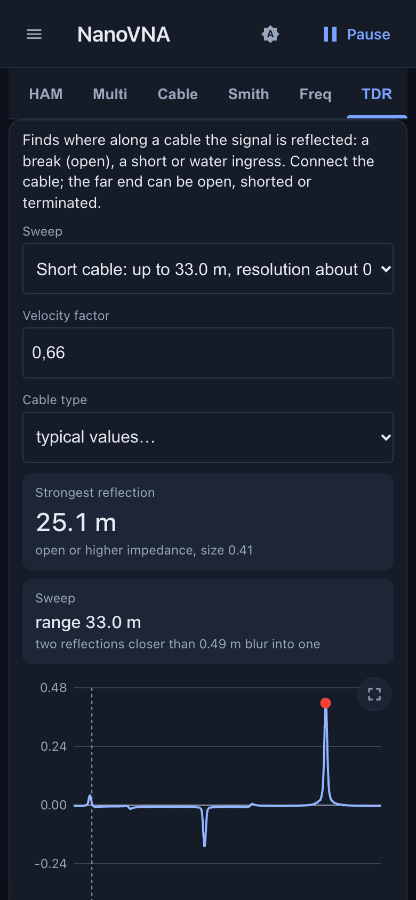
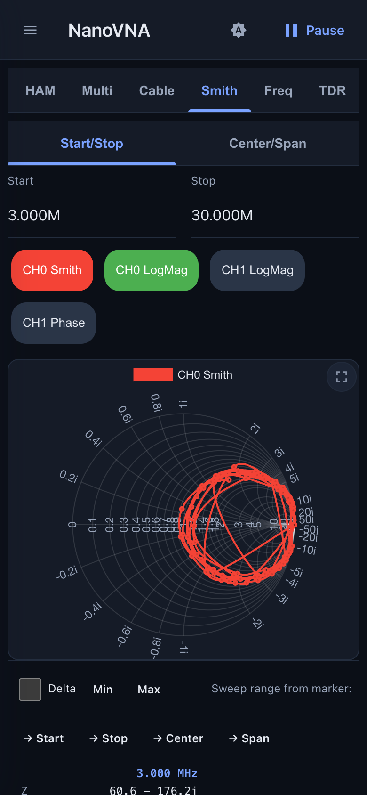
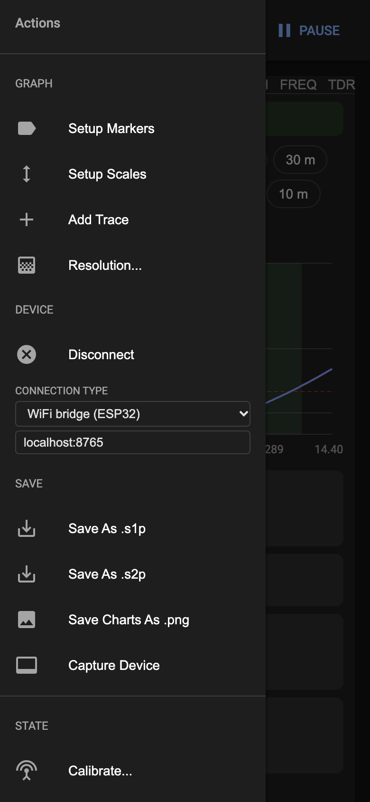
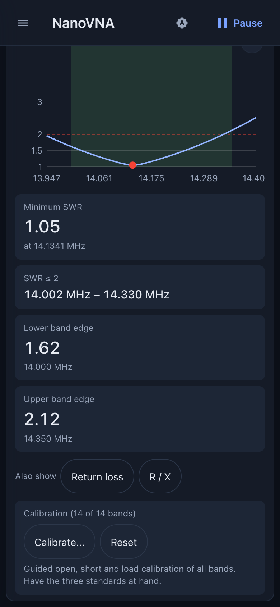

# NanoVNA Remote — Benutzerhandbuch

## 1. Was es ist

Mit NanoVNA Remote misst du eine Antenne mit einem NanoVNA-H von jedem Handy oder Computer im WLAN aus.
Ein Adafruit ESP32-S3 Reverse TFT Feather sitzt neben dem NanoVNA (USB-Kabel), verbindet sich mit deinem WLAN
und stellt die Mess-App bereit. Du musst nichts installieren: Adresse des Feathers im Browser öffnen.

## 2. Hardware

- Adafruit ESP32-S3 Reverse TFT Feather (Produkt 5691), an dessen USB-C-Buchse der NanoVNA-H hängt
  (USB-C-auf-USB-C- oder Adapterkabel; der Feather ist der USB-Host).
- Stromversorgung des Feathers: USB-C über den NanoVNA oder ein LiPo-Akku am Feather.

## 3. Display und Tasten des Feathers

Das Display zeigt den Status: WLAN-Netz und IP-Adresse, ob ein USB-Gerät angeschlossen ist.

 

Die Statusseite (Netzname und Adresse unkenntlich gemacht) und das Menü.

| Taste | Kurz drücken | Lang drücken (0,6 s) |
|---|---|---|
| D0 | hoch | — |
| D2 | runter | — |
| D1 | bestätigen / WLAN-Liste öffnen (auf dem Status-Bildschirm) | Menü (Status-Bildschirm) bzw. zurück / Optionen (in Listen) |

Die unterste Zeile jedes Bildschirms zeigt, was D1 tut. Nach 30 Sekunden ohne Tastendruck springt das Display
zurück auf den Status-Bildschirm.

**Status-Bildschirm:** D1 kurz öffnet die WLAN-Liste, D1 lang das Menü, D2 zeigt einen **QR-Code** (siehe unten).

**QR-Code:** Solange das Einrichtungs-WLAN offen ist, gibt es zwei Codes (D1 wechselt): der erste verbindet mit diesem WLAN
(Handy-Kamera draufhalten und bestätigen), der zweite öffnet die Einrichtungsseite `http://192.168.4.1/wifi`. Manche Handys
öffnen die Einrichtungsseite nach dem Verbinden von selbst (der Feather bietet sie an), ein iPhone eventuell nicht, dann den
zweiten Code scannen. Ist der Feather in deinem Netz,
öffnet der Code die Web-App. Der Code erscheint von selbst, wenn das Einrichtungs-WLAN aufgeht; jede Taste schließt ihn, und er schließt sich von selbst, sobald der Feather ein Netz verbunden hat.
Er ist klein, halte das Handy 10 bis 15 cm vor das Display.

**WLAN-Liste:** deine gespeicherten Netze, `*` markiert das verbundene, `-` ein deaktiviertes; der letzte Eintrag
`[Setup WiFi]` öffnet das Setup-WLAN. D0/D2 wählen, D1 kurz verbindet. D1 lang öffnet die Optionen des gewählten
Netzes: Connect (verbinden), Enable/Disable (aktivieren/deaktivieren), Delete (löschen, mit Rückfrage), Back (zurück).

**Menü:** Choose WiFi (WLAN wählen), Start setup WiFi (Setup-WLAN starten), Rotate display (Bild um 180 Grad drehen,
wird gemerkt), Restart (Neustart), About (die Firmware-Version, zum Beispiel `v1.1.0`), Back (zurück).

Die Anzeige am Gerät und die Webseiten sind englisch.

## 4. Erster Start und WLAN-Einrichtung

1. Beim ersten Start (kein Netz gespeichert) öffnet der Feather ein eigenes WLAN **NanoVNA-Remote**,
   Passwort **nanovna-remote**. Das Display zeigt einen **QR-Code** dafür.
2. Scanne den QR-Code mit der Handy-Kamera und verbinde dich mit dem WLAN. Öffnet sich die Einrichtungsseite nicht von
   selbst, drücke D1 für den zweiten Code und scanne ihn. Am Computer verbindest du dich von Hand (Name und Passwort stehen
   auf dem Status-Bildschirm) und öffnest **http://192.168.4.1/wifi**.
3. **Scan for networks** drücken, dein Netz antippen, Passwort eingeben und **Save** drücken. Dann **Connect**.
   Der Feather verbindet sich mit dem Netz, das Display zeigt die neue Adresse, das Handy kehrt in dein normales
   WLAN zurück. Öffne die Adresse vom Display.

Du kannst bis zu **8 Netze** speichern, zum Beispiel Heim-WLAN und einen Handy-Hotspot. Beim Start probiert der
Feather die gespeicherten Netze in Reichweite, das zuletzt benutzte zuerst. Klappt keins, öffnet er wieder das
Setup-WLAN (und sucht dort jede Minute erneut nach den gespeicherten Netzen, solange niemand damit verbunden ist).

Später wechselst du das Netz mit den Tasten (Abschnitt 3) oder auf der Seite `/wifi` (**Connect**, **On/Off**,
**Delete**). Passwörter werden nie wieder angezeigt.

**D0 halten und RESET drücken** öffnet sofort das Setup-WLAN, ohne ein gespeichertes Netz zu verwenden
(es wird nichts gelöscht).

## 5. Die Web-App

Öffne `http://<Adresse vom Display>/` und drücke **Connect**. Die App läuft im Browser; der Feather reicht nur die Daten durch.

Die Screenshots in diesem Handbuch zeigen simulierte Werte, keine echten Messungen.

Die App lässt sich ohne Hardware ausprobieren: Die [Live-Demo](https://ckonecny.github.io/nanovna-remote/demo/) ist dieselbe App
mit einem simulierten NanoVNA. **connect** drücken und in der Leiste oben wählen, was angeschlossen ist (Antenne,
Open/Short/Load-Standard, Kabel). Auch die Kalibrierung funktioniert mit den simulierten Standards. Die Werte sind
modelliert, nicht gemessen, und die Kalibrierung bleibt nur in deinem Browser.

### 5.1 Überblick

**Kopfzeile.** Links der Menüknopf (öffnet das Seitenmenü, 5.9). Dann der Farbschema-Knopf (Antippen schaltet der Reihe nach
*folgt dem System* (A), *hell* (Sonne) und *dunkel* (Mond) durch; das helle Schema hat einen hohen Kontrast für den Einsatz im
Sonnenlicht; die Wahl merkt sich der Browser) und je nach Zustand **connect** /
**connecting...**. Bei bestehender Verbindung steuert der Knopf daneben die Messung: **Pause** / **Resume** bei Sweeps bis 101
Punkten (die App misst laufend), **Update** / **Stop** bei längeren Sweeps (siehe *Resolution* in 5.9; der Knopf zeigt den
Fortschritt in Segmenten).

**Reiter.** Sieben Ansichten: **Single**, **HAM**, **Multi**, **Cable**, **Smith**, **Freq**, **TDR**. Auf einem schmalen Bildschirm
lässt sich die Reiterleiste seitlich verschieben; der gewählte Reiter bleibt im Blick.

| Reiter | Wofür |
|---|---|
| Single | SWR und Impedanz bei einer Frequenz ablesen |
| HAM | ein Amateurfunkband durchfahren und die beste Frequenz finden |
| Multi | mehrere Bänder gleichzeitig vergleichen |
| Cable | Länge, Verkürzungsfaktor, Dämpfung und Wellenwiderstand eines Koaxkabels messen; Stub-Längen |
| Smith | einen Sweep über einen eigenen Bereich im Smith-Diagramm sehen |
| Freq | einen Sweep über einen eigenen Bereich als Kurven über der Frequenz sehen |
| TDR | herausfinden, wo entlang eines Kabels das Signal reflektiert wird |

**Am Handy.** Auf einem Touchscreen sind Knöpfe, Chips und Felder größer, damit man keinen Nachbarn aus Versehen trifft. Wische
seitlich auf einer freien Fläche der Seite (nicht auf einem Diagramm, Feld oder Knopf), um zur nächsten oder vorigen Ansicht zu
gehen; die Wischbewegung muss schnell und deutlich waagerecht sein und darf nicht am Bildschirmrand beginnen. Im Querformat
rücken die Frequenzeingaben von **Smith** und **Freq** neben das Diagramm, das so die volle Höhe bekommt.

**Diagramm im Vollbild.** Jedes Diagramm (HAM, jede Bandkarte in Multi, die Diagramme von Cable und TDR, Smith und Freq) hat oben
rechts einen kleinen Knopf. Er lässt das Diagramm den ganzen Bildschirm füllen, ohne die übrigen Angaben daneben; derselbe Knopf
(am Computer auch **Esc**) bringt dich zurück. Das Diagramm funktioniert weiter: Cursor, Zoom und Verschieben des Bereichs
verhalten sich wie vorher. In HAM lassen sich die drei Diagramme (SWR, Rückflussdämpfung, R / X) einzeln vergrößern. Drehe das
Handy für das breiteste Diagramm ins Querformat.

Kommen längere Zeit keine Daten, zeigt die Seite einen Hinweis (Kabel prüfen, NanoVNA neu starten).

### 5.2 Single

Eine Frequenz: Tippe auf die Frequenz, um sie zu ändern (Zahlenfeld, siehe 5.7). Die Kacheln zeigen SWR, Rückflussdämpfung, |Z|, R,
X, die Reaktanz als Induktivität oder Kapazität (in Reihe), |Γ| und die Phase. Dazu gibt es ein Diagramm um die Frequenz.

### 5.3 HAM

Sweep über ein Amateurfunkband: Das Band wählst du mit den Bandtasten. Die SWR-Kurve zeigt das Minimum, und die Kacheln nennen das
minimale SWR mit seiner Frequenz, den Bereich mit SWR ≤ 2 und das SWR an beiden Bandgrenzen. Tippe oder klicke ins Diagramm, um
einen Cursor zu setzen, oder drücke **Frequency…** und gib eine genaue Frequenz ein (zum Beispiel 435 M); der Cursor sitzt dann auf
dem nächsten Messpunkt. Die Leiste über dem Diagramm zeigt dort Frequenz, SWR, Rückflussdämpfung, R und X. **Min** und **Max** lassen den Cursor bei
jedem Sweep dem niedrigsten oder höchsten SWR im Band folgen (wie die Marker-Suche des NanoVNA); **Manual** lässt ihn, wo er ist, und
auch ein Tipp ins Diagramm oder eine Frequenzeingabe schaltet auf Manual. **Clear** entfernt einen manuellen Cursor. In den
zusätzlichen Diagrammen zeigt ein Punkt den Wert des Cursors, und der Titel jedes Diagramms nennt den genauen Wert. Die Marker
des Seitenmenüs (5.9) gelten in dieser Ansicht nicht. Unter dem Diagramm ergänzt **Also show**
ein Diagramm der Rückflussdämpfung (dB) und eines für R / X (Wirk- und Blindwiderstand in Ω); beide teilen sich Frequenzachse und
Cursor mit dem SWR-Diagramm. Die Auswahl wird gemerkt. Das Kalibrierfeld unten ist in Kapitel 6 beschrieben.

### 5.4 Multi

Beliebig viele Bänder antippen; jedes bekommt eine Karte mit SWR-Kurve, minimalem SWR und dem Bereich mit SWR ≤ 2. Die Bänder
werden nacheinander gemessen (etwa eine Sekunde pro Band), die Aktualisierung wird also mit jedem Band langsamer. Jede Karte zeigt,
ob ihr Band „calibrated“ (grün) oder „not calibrated“ (rot, unkorrigierte Werte) ist, ein Banner oben fasst die Auswahl zusammen.
Das Kalibrierfeld steht auch unten in der Multi-Ansicht. Die Auswahl wird gemerkt.

### 5.5 Cable

Misst ein Koaxkabel. Kabel an den NanoVNA anschließen, das andere Ende offen oder kurzgeschlossen lassen. Sweep wählen (1–30 MHz
für Kabel bis etwa 150 m, 1–200 MHz bis etwa 20 m) und was gemessen werden soll: die **Länge** (Verkürzungsfaktor eingeben oder
einen typischen Kabeltyp wählen) oder der **Verkürzungsfaktor** (bekannte Länge eingeben). Die Ansicht zeigt das Ergebnis, die
einfache Laufzeit, ob die Phase eine Gerade ist (Plausibilitätsprüfung) und die Dämpfung (einfacher Weg) bei drei Frequenzen, ab
1 m Kabel auch in dB pro 100 m. Zuerst bei abgezogenem Kabel **Zero: nothing attached** drücken: Der NanoVNA hat eine eigene
Laufzeit, die sonst zur Länge addiert würde; der Nullwert wird pro Sweep gemerkt. Ein Kabel, das länger als die Grenze des Sweeps
ist, zeigt ohne Warnung eine falsche, kürzere Länge.

Darunter braucht der **Wellenwiderstand** zwei Messungen am selben Kabel mit demselben Sweep: **Measure open** bei offenem und
**Measure short** bei kurzgeschlossenem Ende (Reihenfolge egal; **Clear** beginnt von vorn). Der Wellenwiderstand ist das
geometrische Mittel der beiden Messwerte, ausgewertet bei den Frequenzen, bei denen beide gut messbar sind; ein für den Sweep zu
kurzes Kabel liefert kein Ergebnis (dann 1–200 MHz). Der Wert hängt von der eigenen Kalibrierung des NanoVNA für den Sweep ab.
**Cut and stub lengths** berechnet für eine Frequenz Viertel- und Halbwellenlänge des Kabels (mit dem Verkürzungsfaktor von oben)
und den kürzesten kurzgeschlossenen oder offenen Stub, der eine vorgegebene Reaktanz zeigt (positiv induktiv, negativ kapazitiv),
auf einem Kabel mit der angegebenen Impedanz; **Use measured impedance** übernimmt das Ergebnis der Messung.

### 5.6 TDR

Findet, wo entlang eines Kabels das Signal reflektiert wird (Bruch, Kurzschluss, Wasser). Sweep passend zur Kabellänge wählen
(short: Auflösung etwa 0,5 m, Reichweite 33 m; medium: etwa 1,5 m, 100 m; long: etwa 5 m, 330 m, bei Verkürzungsfaktor 0,66) und
den Verkürzungsfaktor einstellen (typische Werte je Kabeltyp; deinen eigenen misst du unter **Cable**). Das Diagramm zeigt
Reflexionen über der Entfernung: nach oben offen oder höhere Impedanz, nach unten Kurzschluss oder niedrigere Impedanz; der Peak
bei 0 m ist der Anschluss. Der Marker nennt die stärkste Reflexion dahinter, wenn sie größer als 0,05 ist. Zwei Reflexionen, die
näher als die Auflösung beieinander liegen, verschmelzen zu einer.

### 5.7 Smith und Freq: ein eigener Sweep

**Smith** zeigt die Reflexion im Smith-Diagramm, **Freq** zeigt Kurven über der Frequenz. Beide messen den Bereich, den du über dem
Diagramm eingibst:

- **Start/Stop** oder **Center/Span**: Tippe auf ein Feld, es öffnet das Zahlenfeld. Zahl eintippen und mit der Einheitentaste
  **G**, **M**, **k** oder **x1** (Hz) abschließen; diese Taste bestätigt auch die Eingabe. Die Rücktaste löscht die letzte Ziffer.
- **Trace-Chips** (zum Beispiel `CH0 LogMag`): Jeder Chip ist eine Kurve; die Farbe zeigt, ob sie sichtbar ist. Tippe auf einen
  Chip, um seine Einstellungen zu öffnen (5.8).
- Marker und Skalen (5.9) gelten für diese beiden Ansichten.

Die Kalibrierung der App (Kapitel 6) korrigiert diese Ansichten nur innerhalb der HAM-Bänder; überall sonst sind die Messwerte
unkorrigiert.

### 5.8 Traces

Ein Trace ist eine Kurve in der Ansicht **Freq** oder **Smith**. In den Einstellungen wählst du:

- **Show**: Kurve ein- oder ausblenden.
- **Channel**: CH0 Reflect (die Reflexion am Messanschluss) oder CH1 Through (die Übertragung zwischen den beiden Anschlüssen).
- **Trace Format**: Smith Chart (Z), Smith Chart (Y), Polar (Γ), LogMag, Phase, SWR, Linear, Real, Imag, R, X, |Z|, Rp, Xp, Q oder
  Group delay. Smith, Y Smith und Polar werden in der Ansicht **Smith** gezeichnet, alle anderen in **Freq**. Das Y-Smith-Diagramm
  zeigt die Admittanz im üblichen Gitter; Polar zeigt den Reflexionsfaktor in einer einfachen Γ-Ebene (−1 bis 1). Rp und Xp sind
  der Parallelwiderstand und die Parallelreaktanz, Q ist |X| / R, die Gruppenlaufzeit ist −dφ/dω in ns (aus der Phase zwischen
  benachbarten Punkten, also genug Punkte wählen). R, X, |Z|, Rp, Xp, Q und Group delay teilen sich eine automatische Achse rechts.
- **Trace Type**: Clear (live), Freeze (aktuelle Kurve festhalten), Max Hold, Min Hold, Video Average oder Power Average (mit dem
  **Average Count**).
- **Change Color** und das Papierkorb-Symbol, um den Trace zu löschen.

**Add Trace** im Seitenmenü legt einen neuen an.

**Freq-Diagramm zoomen.** Zwei Finger auf das Diagramm legen: horizontal auseinanderziehen zoomt den Frequenzbereich hinein (zusammenziehen heraus), beide Finger seitlich bewegen verschiebt ihn. Der neue Bereich wird beim Loslassen übernommen und startet einen neuen Sweep. Vertikal auseinanderziehen zoomt die Werteskala (LogMag, SWR oder Phase, je nach erster Kurve), beide Finger auf/ab verschiebt sie; das folgt live. Ein Finger scrollt weiterhin die Seite. Ein schnelles doppeltes Tippen setzt den Zoom zurück (voller Bereich, Standardskala).

Am Computer: das **Mausrad** zoomt den Frequenzbereich um den Mauszeiger (ein Trackpad-Pinch ebenso), **Shift + Mausrad** zoomt die Werteskala, **Ziehen** mit gedrückter Maustaste verschiebt Bereich und Skala, ein **Doppelklick** setzt den Zoom zurück. Die Radschritte werden kurz gesammelt, bevor ein neuer Sweep startet.

**Firmware-Hinweis.** Gibt es für das verbundene NanoVNA (NanoVNA-H oder -H4 des Projekts von hugen79) eine neuere Firmware,
erscheint unter der Kopfzeile ein Hinweis mit Link auf die Release-Seite; **Dismiss** blendet ihn für dieses Release aus. Dafür
braucht das Handy oder der Computer Internetzugang.

### 5.9 Das Seitenmenü

Der Menüknopf öffnet es. Einträge, die eine Verbindung brauchen, sind bis zum Verbinden ausgegraut.

**Graph**
- **Setup Markers**: listet die Marker; das Häkchen blendet einen ein oder aus, der Papierkorb löscht ihn, **Add Marker** fragt
  nach einer Frequenz. Marker erscheinen als Beschriftungen in den Diagrammen **Smith** und **Freq**.
- **Marker-Auswertung**: Unter den Diagrammen **Smith** und **Freq** hat jeder sichtbare Marker eine Spalte mit Impedanz
  (R ± jX), SWR, Rückflussdämpfung, Phase, Q (|X| / R), Serien-Ersatzschaltung (R mit L oder C) und Parallel-Ersatzschaltung
  (R parallel zu L oder C), genommen vom nächstgelegenen Messpunkt der ersten sichtbaren Kurve. Tippe auf einen Spaltenkopf, um
  diesen Marker zum aktiven zu machen. **Delta** zeigt alle anderen Marker relativ zum aktiven (Differenzen statt Werte). **Min**
  und **Max** lassen den aktiven Marker dem Minimum oder Maximum der ersten sichtbaren Kurve des Diagramms folgen (mit jedem
  Sweep; der Knopf bleibt hell, ein erneutes Drücken lässt den Marker, wo er ist). Das Label eines solchen Markers beginnt mit
  **Min** oder **Max**; bei mehreren Kurven steht dort auch die erste Kurve, die den Wert bestimmt (die anderen zeigen ihre Werte bei dieser Frequenz). Die Labels haben einen Rand und einen helleren Hintergrund, damit sie sich auch im dunklen Schema vom
  Diagramm abheben; der Marker ist eine Raute mit Ring. **→ Start**, **→ Stop** und
  **→ Center** setzen den Sweep-Bereich vom aktiven Marker; **→ Span** sweept vom niedrigsten bis zum höchsten sichtbaren Marker.
- **Setup Scales**: Minimum und Maximum der senkrechten Achsen für LogMag (dB), SWR, Phase (°) und Linear.
- **Add Trace**: siehe 5.8.
- **Resolution...**: die Anzahl der Segmente mit je 101 Punkten pro Sweep. 1 bedeutet 101 Punkte; mehr Segmente geben einen
  feineren Sweep, dauern aber länger, und der Knopf in der Kopfzeile wechselt zu Update/Stop.
- **Sweep quality...** (braucht eine Verbindung): die ZF-Bandbreite des NanoVNA (2000 Hz bis 10 Hz; schmaler heißt weniger Rauschen,
  aber ein langsamerer Sweep), die Glättung (aus oder Mittelung 1-8) und die Ausgangsleistung (automatisch oder vier Stufen). Der
  Dialog zeigt, was das Gerät gerade eingestellt hat. Die Einstellungen bleiben im NanoVNA, bis es ausgeschaltet wird.
  Sie gelten für alle Ansichten und für die Kalibrierung. Ein Sweep mit 101 Punkten dauert bei 1000 Hz etwa 0,2 s, bei 100 Hz 1 s und
  bei 10 Hz 10 s; die App wartet entsprechend. Kalibriere mit der Bandbreite, mit der du misst.
- **Port extension...**: die Länge von Kabel oder Adapter zwischen NanoVNA und Messobjekt in Metern (0 schaltet es aus). Die
  App dreht die gemessene Reflexion um die Laufzeit dieser Leitung zurück (Länge und Verkürzungsfaktor der Ansicht Cable),
  sodass Smith-Diagramm, Impedanz und SWR sich auf das Leitungsende beziehen. Es gilt für die Reflexion in Single, HAM, Multi,
  Smith und den Diagrammen, nicht für die Ansichten Cable und TDR und nicht für die Transmission (CH1). Kalibriert wird am Anschluss des NanoVNA, nicht am Leitungsende.

**Device**
- **Connect** / **Disconnect**.
- **Connection Type**: normalerweise *Auto*. *WiFi bridge (ESP32)* verbindet über den Feather; das Feld darunter nimmt seinen Namen
  oder seine Adresse (`nanovna.local` oder die IP-Adresse). *WebSerial* und *WebUSB* verbinden mit einem NanoVNA, der am Computer
  selbst steckt.

**Save**
- **Save As .s1p** speichert den Sweep als Touchstone-Datei; in **Multi** eine Datei je Band. **Save As .s2p** speichert beide
  Kanäle (Kanal 1 wird nur gemessen, solange ein CH1-Trace sichtbar ist, sonst ist er null).
- **Save Charts As .png** speichert alle Diagramme der HAM- oder Multi-Ansicht als ein Bild; in **Smith** und **Freq** speichert
  der Eintrag das jeweilige Diagramm. Dateien aus HAM und Multi heißen nach Band und Datum, zum Beispiel `20m-20261102.s1p`, alle
  anderen nach Datum und Uhrzeit (`nanovna-20261102-143000.s1p`). Gespeichert werden die Werte wie angezeigt, mit der Kalibrierung
  der App.
- **Capture Device**: zeigt den Bildschirm des NanoVNA. **Refresh** macht ein neues Bild, **Download** speichert es.

**State**
- **Calibrate...**: Kalibrierung des NanoVNA selbst (Reset, Open, Short, Load, Thru, Done und Speichern in Platz 0–4). Zum Messen
  mit dieser App nimmst du stattdessen die Kalibrierung der App (Kapitel 6).
- **Recall 0–4**: lädt einen im NanoVNA gespeicherten Zustand (Sweep-Bereich und seine Kalibrierung).

**About**: **Version** (Versionsinformation) und **Quit** (schließt das Fenster). Ganz unten enthält das Seitenmenü ein Protokoll
der Verbindung zur Fehlersuche (**Clear Logs**).

## 6. Kalibrierung

Die App korrigiert die Messwerte selbst mit einer Open/Short/Load-Kalibrierung für **alle HAM-Bänder**; die eigene Kalibrierung des
NanoVNA ist dabei abgeschaltet.

Kalibriere einmal im Reiter **HAM** oder **Multi** mit Open, Short und Load am Anschluss (oder am Ende des Kabels, durch das du
misst). Drücke **Calibrate...**; das Feld führt dich dann der Reihe nach durch die drei Normale. Eine Zeile **Open, Short, Load**
zeigt den Fortschritt (ein Haken für jedes gemessene Normal). Im aktuellen Schritt nennt das Feld das Normal, das du anstecken
sollst; stecke es an und drücke **Measure Open** (danach **Measure Short**, **Measure Load**). Alle Bänder werden in einem Zug gemessen, und das Feld geht von selbst
zum nächsten Schritt. **Back** wiederholt das vorige Normal, **Cancel** bricht ab und verwirft das bisher Gemessene (eine frühere
Kalibrierung bleibt, bis eine neue vollständig ist).

Die App prüft auch, was sie gemessen hat: ein Normal, das kaum reflektiert, obwohl Open oder Short verlangt war, ein Open und ein
Short, die gleich aussehen, oder ein Load, das stark reflektiert, werden gemeldet („Is the right standard attached?“, auf
Englisch). Dann drückst du **Measure again**, nachdem du das richtige Normal angesteckt hast, oder **Use anyway**, um die Messung
zu behalten. Die Korrektur eines Bandes wird erst berechnet, wenn alle drei Normale gemessen sind. Ist das letzte gemessen, zeigt
das Feld, wie viele Bänder kalibriert sind; **Done** schließt es.

Die Kalibrierung wird im Feather gespeichert, jeder Browser nutzt sie. **Reset** löscht sie. Ohne Kalibrierung zeigt die Seite eine
Warnung; HAM und Multi zeigen für jedes Band, ob es kalibriert ist.

## 7. Firmware aktualisieren

Am einfachsten geht es mit dem **[Installer im Browser](https://ckonecny.github.io/nanovna-remote/install/)** (Chrome oder
Edge am Computer): Feather in den Bootloader versetzen (D0 halten, RESET tippen, D0 loslassen), **Connect** klicken, den
Port wählen und **Install** wählen. Er installiert das neueste Release und löscht, wie die First-Flash-Datei unten, die gespeicherten WLAN-Netze.
Die Kalibrierung bleibt erhalten.

Jedes [Release](https://github.com/ckonecny/nanovna-remote/releases) enthält zwei fertige Dateien:

- **`...-first-flash.bin`** für die erste Installation (oder zum Neustart von null) per USB: D0 halten, RESET tippen, D0
  loslassen, dann `pip install esptool` und `esptool.py --chip esp32s3 write_flash 0x0 <Datei>`. Das löscht auch die
  gespeicherten WLAN-Netze.
- **`...-update.bin`** für spätere Updates per WLAN, ohne Kabel:
  öffne `http://<Adresse>/update` (auch unten auf der Seite `/wifi` verlinkt), wähle die Datei und drücke **Upload and restart**; die Seite zeigt die installierte Version. Der Feather startet neu; WLAN-Netze und Kalibrierung bleiben.
  Mit einem Terminal geht es auch als `curl --data-binary @<Datei> http://<Adresse>/api/ota`.

Wer die Firmware selbst baut: `firmware/tools/ota.sh <Adresse>` baut und lädt per WLAN hoch; per USB mit PlatformIO
hochladen. Siehe `firmware/README.md`.

## 8. Fehlersuche

| Problem | Was tun |
|---|---|
| Das Display bleibt dunkel | RESET drücken. Bleibt es dunkel, per USB neu flashen. |
| Kein Setup-WLAN sichtbar | D0 halten und RESET drücken. Nach **NanoVNA-Remote** suchen (nicht nach einem älteren Namen). |
| Die Seite öffnet nicht | IP-Adresse vom Display verwenden; `nanovna.local` funktioniert nicht überall. |
| „USB: no device“ | USB-Kabel zwischen Feather und NanoVNA prüfen; der NanoVNA muss eingeschaltet sein. |
| Daten bleiben aus, NanoVNA hängt | NanoVNA neu starten (er kann nach einem Feather-Reset während einer Übertragung hängen). |
