# NanoVNA Remote — User Manual

## 1. What it is

NanoVNA Remote lets you measure an antenna with a NanoVNA-H from any phone or computer on your WiFi.
An Adafruit ESP32-S3 Reverse TFT Feather sits next to the NanoVNA (USB cable), joins your WiFi and
serves the measurement app. You do not install anything: open the Feather's address in a browser.

## 2. Hardware

- Adafruit ESP32-S3 Reverse TFT Feather (product 5691) with a NanoVNA-H connected to its USB-C port
  (use a USB-C to USB-C or adapter cable; the Feather is the USB host).
- Power for the Feather: USB-C power via the NanoVNA, or a LiPo battery on the Feather.

## 3. The Feather's display and buttons

The display shows the status: WiFi network and IP address, whether a USB device is plugged in.

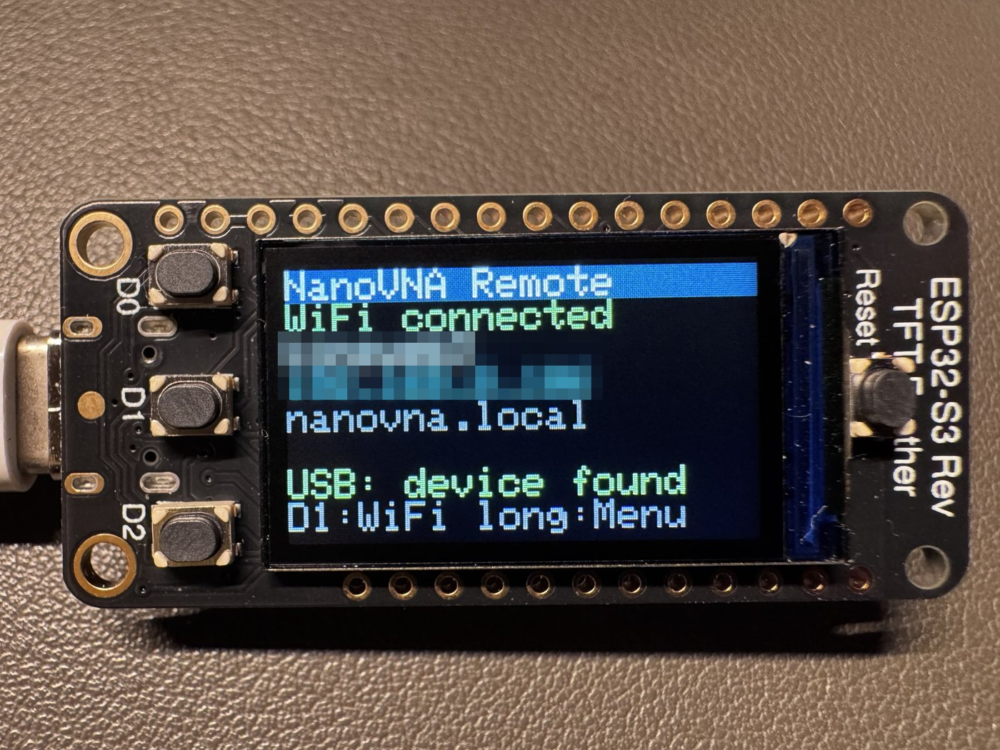 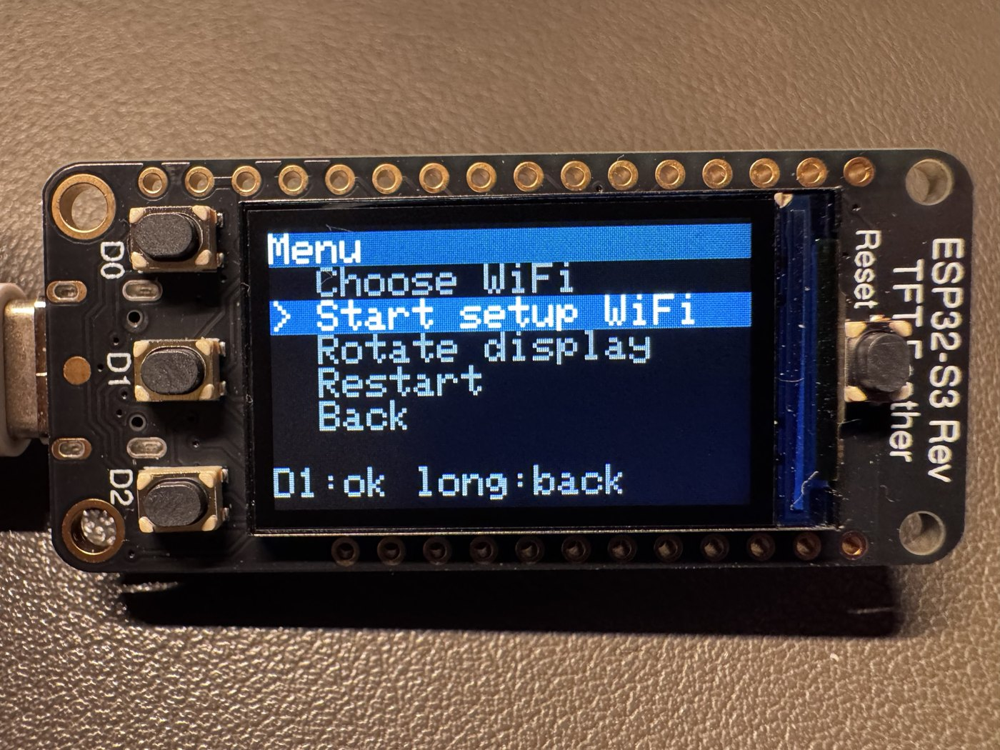

The status screen (network name and address blurred) and the menu.

| Button | Short press | Long press (0.6 s) |
|---|---|---|
| D0 | up | — |
| D2 | down | — |
| D1 | confirm / open the WiFi list (on the status screen) | menu (status screen) or back / options (in lists) |

The bottom line of every screen shows what D1 does. After 30 seconds without a key the display
returns to the status screen.

**Status screen:** D1 short opens the WiFi list; D1 long opens the menu; D2 shows a **QR code** (see below). The first line reads "WiFi connected", and "WiFi + browser" while a browser is connected to the NanoVNA through the device.

**QR code:** while the setup WiFi is open there are two codes (D1 switches between them): the first joins that WiFi (point the
phone's camera at it and confirm), the second opens the setup page `http://192.168.4.1/wifi`. Some phones open the setup page by
themselves after joining (the Feather offers it), an iPhone may not, then scan the second code. While the Feather is on your network the code opens the web app. The code
appears by itself when the setup WiFi opens; any key closes it, and it closes by itself once the Feather has joined a network. It is small, hold the phone 10 to 15 cm from the display.

**WiFi list:** your saved networks, `*` marks the connected one and `-` a disabled one; the last entry
`[Setup WiFi]` opens the setup WiFi. D0/D2 select, D1 short connects. D1 long opens the options of the
selected network: Connect, Enable/Disable, Delete (with a question), Back.

**Menu:** Choose WiFi, Start setup WiFi, Rotate display (turns the picture by 180 degrees, remembered),
Restart, About (the firmware version, for example `v1.1.0`), Back.

## 4. First start and WiFi setup

1. On first start (no saved network) the Feather opens its own WiFi **NanoVNA-Remote**,
   password **nanovna-remote**. The display shows a **QR code** for it.
2. Scan the QR code with the phone's camera and join the WiFi. If the setup page does not open by itself, press D1 for the
   second code and scan it. On a computer join the WiFi by hand (name and password are on the status screen) and open
   **http://192.168.4.1/wifi**.
3. Press **Scan for networks**, tap your network, enter its password and press **Save**. Press
   **Connect**. The Feather joins that network and the display shows the new address; the phone returns to
   your normal WiFi. Open the address shown on the display.

**Android 17:** if Chrome cannot open the address (`ERR_TOO_MANY_RETRIES`) while another browser can, allow Chrome the
local network once: **Settings → Apps → Chrome → Permissions → Nearby devices → Allow** (checked on a Pixel 9a).

You can save up to **8 networks**, for example your home WiFi and a phone hotspot. On start the Feather
tries the saved networks that are in range, the one used last first. If none works it opens the setup WiFi
again (and looks for the saved networks again every minute while nobody is connected to it).

To switch networks later use the buttons (section 3) or the `/wifi` page (**Connect**, **On/Off**, **Delete**).
Passwords are never shown again.

**Hold D0 while pressing RESET** to open the setup WiFi right away without joining a saved network
(nothing is deleted).

## 5. The web app

Open `http://<address on the display>/` and press **Connect**. The app runs in the browser; the Feather only passes the
data on.

The screenshots in this manual show simulated values, not real measurements.

You can try the app without hardware: the [live demo](https://ckonecny.github.io/nanovna-remote/demo/) is the same app with a
simulated NanoVNA. Press **connect**, and choose in the bar at the top what is attached (antenna, open / short / load
standard, cable). The calibration works on the simulated standards too. The values are modelled, not measured, and the
calibration stays in your browser only.

### 5.1 Overview

**Header.** Left: the menu button (opens the side menu, 5.9). Then the colour scheme button (tap it to cycle through
*follows the system* (A), *light* (sun) and *dark* (moon); the light scheme has a high contrast for use in sunlight; the choice
is remembered in the browser) and, depending on the state, **connect** / **connecting...**. When connected, the button next to it controls the measurement: **Pause** / **Resume** for
sweeps of up to 101 points (the app measures continuously), **Update** / **Stop** for longer sweeps (see *Resolution* in 5.9;
the button shows the progress in segments).

**Tabs.** Seven views: **Single**, **HAM**, **Multi**, **Cable**, **Smith**, **Freq**, **TDR**. On a narrow screen the tab bar
scrolls sideways; the selected tab stays in sight.

| Tab | Use it to |
|---|---|
| Single | read SWR and impedance at one frequency |
| HAM | sweep one amateur band and find the best frequency |
| Multi | compare several bands at once |
| Cable | measure length, velocity factor, loss and characteristic impedance of a coax cable; stub lengths |
| Smith | see a sweep of your own range in a Smith chart |
| Freq | see a sweep of your own range as curves over frequency |
| TDR | find where along a cable the signal is reflected |

**On a phone.** On a touch screen the buttons, chips and fields are larger so that neighbours are not hit by mistake. Swipe
sideways on a free area of the page (not on a chart, a field or a button) to go to the next or previous view; the swipe must be
quick, clearly horizontal and not start at the screen edge. Held sideways, the frequency inputs of **Smith** and **Freq** move
next to the chart so that it gets the full height.

**Chart full screen.** Every chart (HAM, each band card in Multi, the Cable and TDR charts, Smith and Freq) has a small
button in its top right corner. It makes the chart fill the whole screen, without the other information next to it; the same button
(or **Esc** on a computer) takes you back. The chart keeps working: cursor, zoom and moving the range behave as before. In
HAM the three charts (SWR, return loss, R / X) can each be enlarged. Turn the phone sideways for the widest chart.

If no data arrives for a while the page shows a notice (check the cable, restart the NanoVNA).

### 5.2 Single

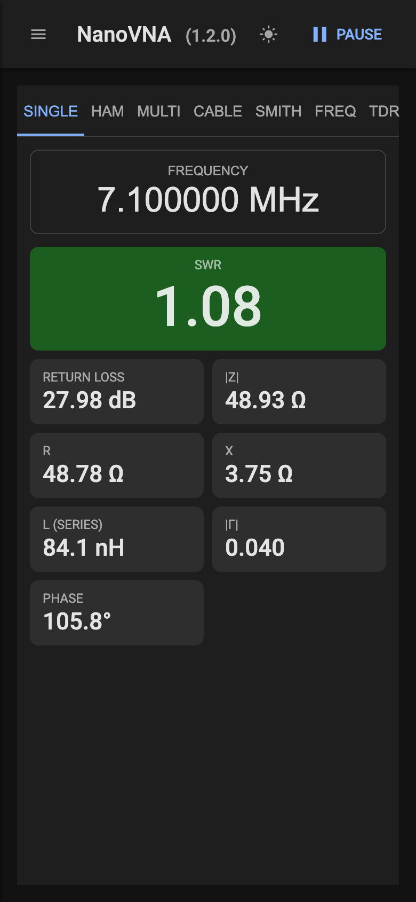

One frequency: tap the frequency to change it (keypad, see 5.7). The tiles show SWR, return loss, |Z|, R, X, the reactance as
inductance or capacitance (series), |Γ| and the phase. A chart around the frequency is shown as well.

**Log over time.** The section at the bottom (folded at first) records the readings of the chosen frequency and draws them over time, to watch
drift (temperature, a wet antenna) or to tune a matching network with live feedback.

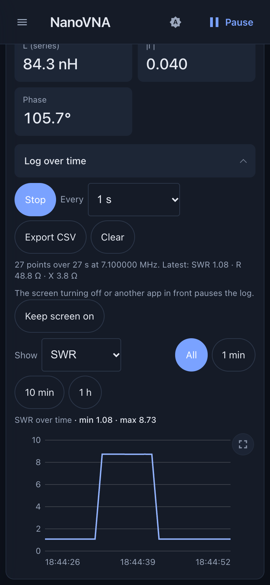

The log over time (simulated values): SWR of the chosen frequency, here with another load connected for a few seconds.

- **Start** / **Stop** begin and end the recording; **Continue** carries on with an existing log. **Every** sets the time between two points
  (every reading of the device, 1 s, 5 s, 30 s or 1 min). It records only while the Single view is open, at the frequency shown, and not
  during a calibration; a gap (another view, paused) is not joined up in the chart.
- **Show** chooses what the chart draws: **SWR**, **Return loss**, **R / X**, **|Z|**, **Rp / Xp**, **Q**, **|Γ|** or **Phase**; the window is **All** of the log or the
  last 1 min, 10 min or 1 h. The log keeps the raw reading only, so you can change the format at any time, also for a log that is already running.
  Values far out (an open end, a short circuit) are drawn at the edge of the chart, and a nearly constant value stays a calm line. Tap the chart to
  read the values at that time. The chart button at its top right shows it full screen.
- **Export CSV** saves the log for a spreadsheet: time, seconds since the first point, frequency, the raw reflection (Re, Im) and all formats
  (SWR, return loss, R, X, |Z|, Rp, Xp, Q, |Γ|, phase). **Clear** deletes it.
- The log has no time limit. Above 20,000 points it keeps every second point and records half as often from then on (the note under the
  buttons says so), so the whole history stays in the chart.
- The log is stored in the browser (IndexedDB) while it runs and survives a reload or a closed tab; it then waits as stopped
  until you press **Continue**. The browser deletes it with "clear site data" or in a private window, and the address matters: the page opened as
  `nanovna.local` and as the IP address have separate logs. Export a log you want to keep.
- A phone that locks its screen or switches to another app stops the page, and the log gets a gap. **Keep screen on** (menu, Device)
  holds the screen on where the browser offers that: it needs an HTTPS page, so on the device's own page (plain HTTP) it is usually
  not available, and the menu entry says so. Keep the screen unlocked then.

### 5.3 HAM

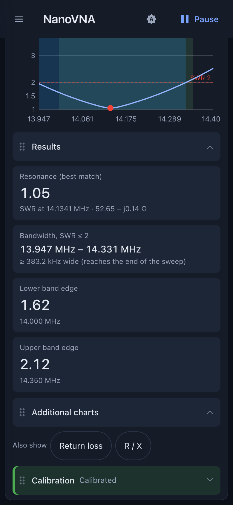

**Foldable, movable sections.** The HAM view has six sections with a header you can tap: **Band** (the band buttons), **Tools** (SWR limit,
reference, cursor controls), **SWR chart**, **Results** (the tiles), **Additional charts** and **Calibration**. A folded section shows its state in one
line: the chosen band, or for example "Limit 2 · Reference on · Cursor 14.1204 MHz, SWR 1.14". Tools and Calibration start folded, the
others open; the choice is remembered per browser. A guided calibration that is running opens the Calibration section by itself.
**Save Charts As .png** leaves out the charts of a folded section.

To put a section somewhere else, drag it by the dotted handle at the left of its header and drop it between the others (with the
keyboard: focus the handle and press the up or down arrow). The order is remembered per browser and per view; the warning banner stays at the top.

**Calibration status.** When the chosen band is calibrated, the Calibration header is green and there is no banner. Without a
calibration an orange banner at the top says so ("NOT calibrated: values are uncorrected"), because the values are then not corrected.

Sweep over an amateur band: pick the band with the band buttons. The SWR curve shows the minimum, and the tiles name the best match
(the minimum SWR with its frequency and the impedance R + jX there), the resonance (below), the bandwidth around it where SWR stays at or below the
**SWR limit** (1.5, 2 or 3, chosen above the chart and remembered; the limit is drawn as a red line and the bandwidth shaded blue) and
the SWR at both band edges. **Resonance and best match are not the same.** The lowest SWR is where the match is best, but an antenna is resonant where
the reactance X crosses 0 Ω going up (inductive above, capacitive below). The two coincide only if the feed resistance there is close to
50 Ω. The **Resonance (X = 0 Ω)** tile gives that frequency with R and SWR there and how far it lies from the SWR minimum; it is drawn
as an orange dotted line in the SWR chart and in the R / X chart. With several crossings the one nearest to the SWR minimum is shown, and
the tile says "none" if X does not cross 0 Ω in the band. When tuning, shorten or lengthen the antenna until both points meet inside the
band. The usable bandwidth is still defined by the SWR limit. **Length hint.** Below the resonance figures the tile adds a rule of thumb: for a simple antenna (dipole, ground plane, long wire) the resonance moves inversely with the length, so a resonance below the band centre means the antenna is about that many percent too long (shorten it), above it too short (lengthen it). It is only a guide: loading coils, traps, fan dipoles, the ground and the surroundings shift the resonance differently, and nothing is shown within 0.2 % of the band centre. If X crosses 0 Ω only outside the band (but inside the sweep), the tile says so and still gives the hint. The bandwidth is read between the measured points by interpolation; if it runs to the end of the sweep,
the tile says so and shows the width as "≥". Tap or click into the chart to place a cursor, or press
**Frequency…** and type an exact frequency (for example 435 M); the cursor sits on the nearest measured point. The bar above the
chart shows frequency, SWR, return loss, R and X there. **Min** and **Max** make the cursor follow the lowest or highest SWR in the
band with every sweep (like the NanoVNA's marker search); **Manual** keeps it where it is, and tapping a chart or entering a
frequency also switches to Manual. **Clear** removes a manual cursor. In the additional charts the cursor shows its value as a dot,
and the title of each chart repeats the exact value. The markers of the side menu (5.9) do not apply to this view. Under the chart, **Also show** adds a return loss chart (dB) and an
R / X chart (resistance and reactance in Ω); both share the frequency axis and the cursor of the SWR chart. The choice is
remembered. **Reference.** The **Reference** row under the SWR limit keeps one sweep per band for comparison, for example before and after
you trim an antenna. **Save current sweep** stores the live SWR curve (it is only enabled once the sweep of the selected band is on
screen); it is drawn as a grey line behind the live one, and the row says when it was saved (with the date if that was not today) and where its minimum lies. **Shown /
Hidden** switches the line on or off, **Replace** stores the live sweep instead, **Delete** removes it. While the line is shown the
Best match tile adds the change against the reference (SWR and frequency of the minimum). The reference is kept per band in the browser,
so a phone and a computer have their own; if it was saved with a different calibration state than the live sweep, a warning says so.
The calibration panel at the bottom is described in chapter 6.

### 5.4 Multi

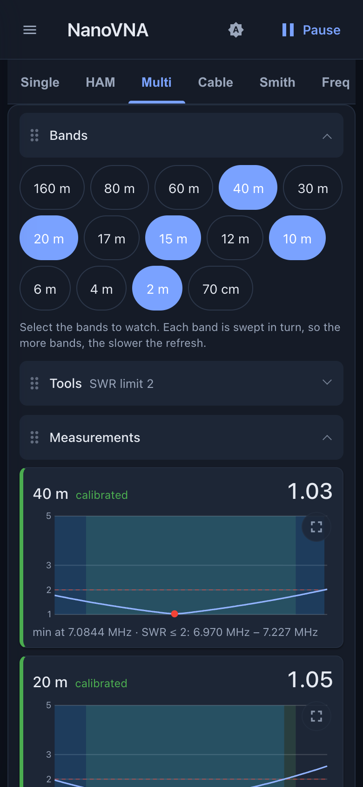

Tick any number of bands; each gets a card with its SWR curve, minimum SWR and the bandwidth around the minimum where SWR stays at or below the **SWR limit** (1.5, 2 or 3, the same choice as in HAM; the limit line is red, the bandwidth shaded blue). Below the chart a second line gives the **resonance** of the band (where the reactance X crosses 0 Ω going up, with R and SWR there, as in HAM) and draws it as an orange dotted line; the dot in front is blue when the resonance lies inside the band, orange when it lies outside the band (the frequency is named) and grey when X does not cross 0 Ω in the sweep. The card colour (green, orange, red) stays a statement about the match, the lowest SWR, only. When the resonance lies outside the band, the line adds the same length hint as in HAM ("antenna about 2.3 % too long"). The bands are swept one
after another (about one second each), so the refresh slows down with every band added. Every card says whether its band is
"calibrated" (green) or "not calibrated" (red, uncorrected values). The view is built like HAM: foldable, movable sections **Bands**
(the selection, shown in the header while folded), **Tools** (the SWR limit, folded at first), **Measurements** (the cards) and
**Calibration** (green header when all selected bands are calibrated). An orange banner at the top appears only when a selected band
is not calibrated (or only some of them are); with no band selected there is no banner. The selection is remembered.

### 5.5 Cable

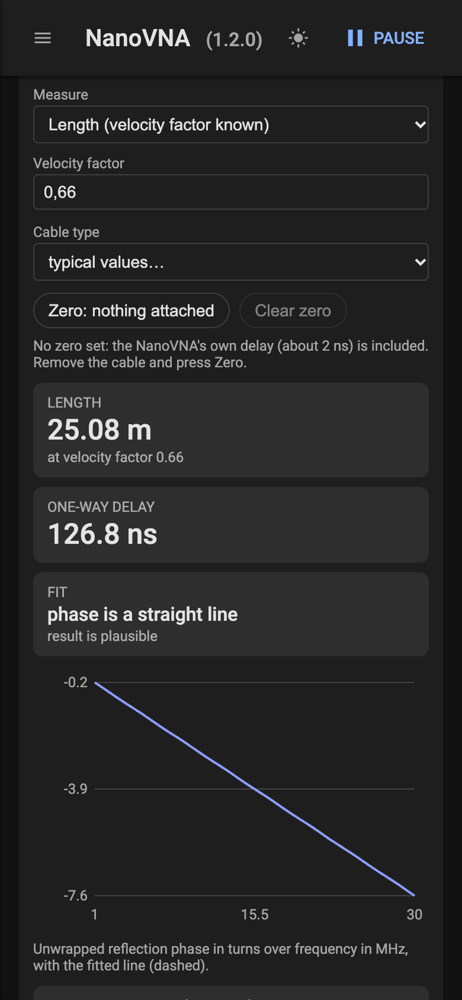

Measures a coax cable. Connect it to the NanoVNA and leave the far end open or shorted. Pick the sweep (1–30 MHz for cables up to
about 150 m, 1–200 MHz for up to about 20 m) and what to measure: the **length** (enter the velocity factor or pick a typical cable
type) or the **velocity factor** (enter the known length). The view shows the result, the one-way delay, whether the phase is a
straight line (a plausibility check) and the one-way loss at three frequencies (dB per 100 m from 1 m of cable on). First press
**Zero: nothing attached** with the cable removed: the NanoVNA has a delay of its own that would otherwise be added to the length;
the zero is remembered per sweep. A cable longer than the limit of the sweep shows a wrong, shorter length without any warning.

Below the results, **Characteristic impedance** needs two measurements of the same cable with the same sweep: press **Measure
open** with the far end open and **Measure short** with it shorted (in either order; **Clear** starts again). The impedance is the
geometric mean of the two readings, taken over the frequencies where both are well measurable; a cable that is too short for the
sweep gives no result (use 1–200 MHz). The value depends on the NanoVNA's own calibration for the sweep. **Cut and stub lengths**
works out, for a frequency, the quarter and half wavelength of the cable (using the velocity factor above) and the shortest shorted
or open stub that shows a given reactance (positive inductive, negative capacitive) on a cable of the given impedance; **Use
measured impedance** copies the result of the measurement.

### 5.6 TDR

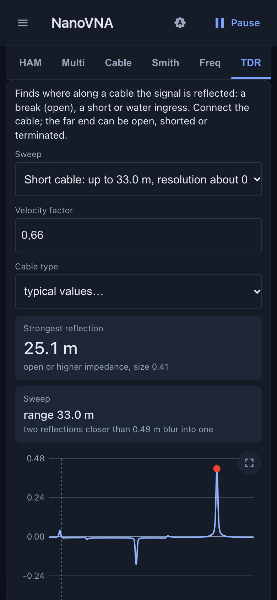

Finds where along a cable the signal is reflected (a break, a short, water). Pick the sweep for the cable length (short:
resolution about 0.5 m, range 33 m; medium: about 1.5 m, 100 m; long: about 5 m, 330 m, at velocity factor 0.66) and set the
velocity factor (typical values by cable type; measure yours in **Cable**). The chart shows reflections over distance: up means
open or higher impedance, down means short or lower impedance; the peak at 0 m is the connector. The marker names the strongest
reflection beyond it, if it is larger than 0.05. Two reflections closer than the resolution blur into one.

### 5.7 Smith and Freq: your own sweep

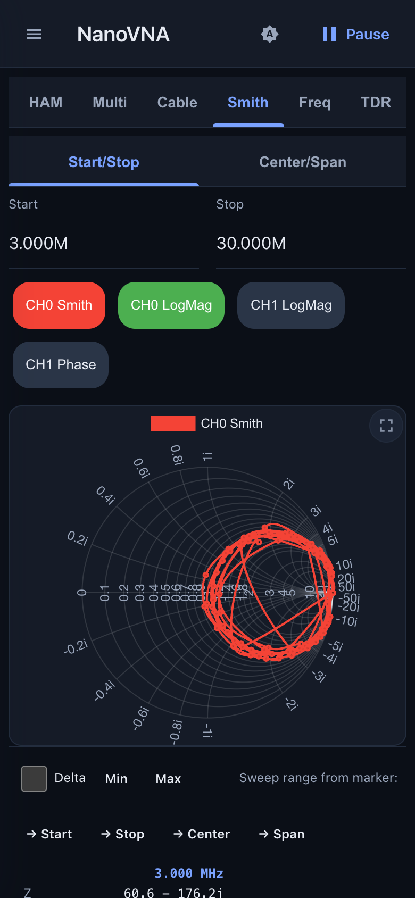

**Smith** shows the reflection in a Smith chart, **Freq** shows curves over frequency. Both sweep the range you enter above the
chart:

- **Start/Stop** or **Center/Span**: tap a field to open the keypad. Type the number and finish with the unit key **G**, **M**,
  **k** or **x1** (Hz); that key also confirms the input. The backspace key deletes the last digit.
- **Trace chips** (for example `CH0 LogMag`): every chip is one curve; the colour shows whether it is visible. Tap a chip to open
  its settings (5.8).
- Markers and scales (5.9) apply to these two views.

The app-side calibration (chapter 6) corrects these views only inside the HAM bands; everywhere else the readings are
uncorrected.

### 5.8 Traces

A trace is one curve in the **Freq** or **Smith** view. In the settings you choose:

- **Show**: show or hide the curve.
- **Channel**: CH0 Reflect (the reflection at the measurement port) or CH1 Through (the transmission between the two ports).
- **Trace Format**: Smith Chart (Z), Smith Chart (Y), Polar (Γ), LogMag, Phase, SWR, Linear, Real, Imag, R, X, |Z|, Rp, Xp, Q or
  Group delay. The Smith, Y Smith and Polar formats are drawn in the **Smith** view, all others in **Freq**. The Y Smith chart
  reads admittance on the usual grid; Polar plots the reflection coefficient on a plain Γ plane (−1 to 1). Rp and Xp are the
  parallel resistance and reactance, Q is |X| / R, group delay is −dφ/dω in ns (taken from the phase between neighbouring
  points, so use enough points). R, X, |Z|, Rp, Xp, Q and Group delay share an automatic axis on the right.
- **Trace Type**: Clear (live), Freeze (hold the current curve), Max Hold, Min Hold, Video Average or Power Average (with the
  **Average Count**).
- **Change Color** and the bin symbol to delete the trace.

**Add Trace** in the side menu creates a new one.

**Zooming the Freq chart.** Put two fingers on the chart: spreading them horizontally zooms the frequency range in (pinching zooms it out), moving both sideways shifts it. The new range is applied when you lift the fingers and starts a new sweep. Spreading vertically zooms the value scale (LogMag, SWR or Phase, whichever the first trace uses) and moving both fingers up or down shifts it; this follows live. One finger still scrolls the page. A quick double tap resets the zoom (full range, default scale).

On a computer: the **mouse wheel** zooms the frequency range around the pointer (a trackpad pinch does the same), **Shift + wheel** zooms the value scale, **dragging** with the mouse button held shifts the range and the scale, and a **double click** resets the zoom. The wheel steps are collected for a moment before a new sweep starts.

**Firmware note.** If a newer firmware exists for the connected NanoVNA (NanoVNA-H or -H4 of the hugen79 project), a note with a link
to the release page appears under the header; **Dismiss** hides it for that release. It needs internet access on the phone or computer.

### 5.9 The side menu

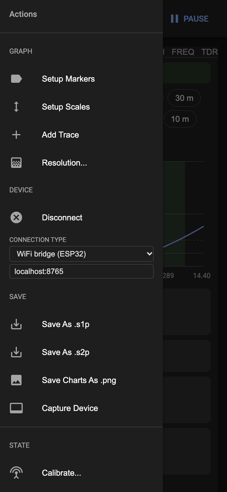

The menu button opens it. Entries that need a connection are greyed out until you are connected.

**Graph**
- **Setup Markers**: lists the markers; the tick shows or hides one, the bin deletes it, **Add Marker** asks for a frequency.
  Markers appear as labels in the **Smith** and **Freq** charts.
- **Marker readout**: under the **Smith** and **Freq** charts, each shown marker has a column with the impedance (R ± jX), SWR,
  return loss, phase, Q (|X| / R), the series equivalent (R with L or C) and the parallel equivalent (R in parallel with L or
  C), taken from the nearest measured point of the first visible trace. Tap a column head to make that marker the active one.
  **Delta** shows every other marker relative to the active one (differences instead of values). **Min** and **Max** make the
  active marker follow the minimum or maximum of the first visible trace of the chart (with every sweep; the button stays lit, and
  pressing it again leaves the marker where it is). The label of such a marker starts with **Min** or **Max**; with several traces it also names the first trace, which decides (the other traces show their values at that frequency). The labels have a
  border and a lighter background so that they show against the chart in the dark scheme too; the marker is a diamond with a ring. **→ Start**, **→ Stop** and **→ Center** set the sweep
  range from the active marker; **→ Span** sweeps from the lowest to the highest shown marker.
- **Setup Scales**: minimum and maximum of the vertical axes for LogMag (dB), SWR, Phase (°) and Linear.
- **Value display...**: how values are shown. Impedance as **R + jX** or as **|Z| and angle**; the match with **SWR** or **Return loss** as the main value
  (the other stays in the cursor readout, the marker table and the Freq tiles). It applies to the Freq tiles, the marker table, and the HAM results,
  cursor and Multi cards. Chart axes do not change. The choice is kept in the browser.
- **Add Trace**: see 5.8.
- **Resolution...**: the number of 101-point segments per sweep. 1 means 101 points; more segments give a finer sweep but take
  longer, and the header button changes to Update/Stop.
- **Keep screen on** (Device group): keeps the screen from turning off while the page is open (Screen Wake Lock API). Browsers allow it on
  HTTPS pages only, so on the device's own page it is usually greyed out; see 5.2 for the log. The choice is kept in the browser.
- **Sweep quality...** (needs a connection): the NanoVNA's IF bandwidth (2000 Hz down to 10 Hz; narrower means less noise but a
  slower sweep), smoothing (off or averaging 1-8) and output power (automatic or four levels). The dialog shows what the device
  has now. The settings stay in the NanoVNA until it is switched off. They apply to every view and to the calibration. A sweep of
  101 points takes about 0.2 s at 1000 Hz, 1 s at 100 Hz and 10 s at 10 Hz; the app waits accordingly. Calibrate at the bandwidth you measure with.
- **Port extension...**: the length of cable or adapter between the NanoVNA and the device under test, in metres (0 switches it
  off). The app turns the measured reflection back by the delay of that line (length and the velocity factor of the Cable
  view), so Smith chart, impedance and SWR refer to the end of the line. It applies to the reflection in Single, HAM, Multi,
  Smith and the charts, not to the Cable and TDR views or to transmission (CH1). Calibrate at the NanoVNA's port, not at the end of the line.

**Device**
- **Connect** / **Disconnect**.
- **Connection Type**: normally *Auto*. *WiFi bridge (ESP32)* connects through the Feather; the field below takes its name or
  address (`nanovna.local` or the IP address). *WebSerial* and *WebUSB* connect to a NanoVNA plugged into the computer itself.

**Save**
- **Save As .s1p** saves the sweep as a Touchstone file; in **Multi** it saves one file per band. **Save As .s2p** saves both
  channels (channel 1 is only measured while a CH1 trace is shown, otherwise it is zero).
- **Save Charts As .png** saves all charts of the HAM or Multi view as one picture; in **Smith** and **Freq** the entry saves
  that chart. HAM and Multi files are named after band and date, for example `20m-20261102.s1p`, all others after date and
  time (`nanovna-20261102-143000.s1p`). The values are saved as displayed, with the app-side calibration applied.
- **Capture Device**: shows the NanoVNA's own screen. **Refresh** takes a new picture, **Download** saves it.

**State**
- **Calibrate...**: calibration of the NanoVNA itself (Reset, Open, Short, Load, Thru, Done and save into slot 0–4). For
  measuring with this app use the app-side calibration (chapter 6) instead.
- **Recall 0–4**: loads a state saved in the NanoVNA (sweep range and its calibration).

**About**: **Version** (version information) and **Quit** (closes the window). At the bottom the side menu holds a log of the
connection for troubleshooting (**Clear Logs**).

## 6. Calibration

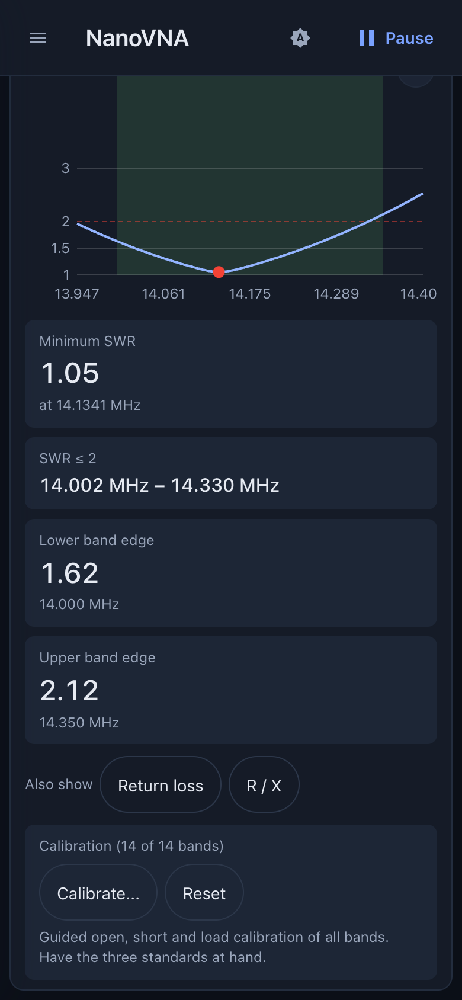

The app corrects the readings itself with an open/short/load calibration of **all HAM bands**; the NanoVNA's own calibration is
switched off while it is in use.

Calibrate once, on the **HAM** or **Multi** tab, with the open, short and load standards at the connector (or at the
end of the cable you measure through). Press **Calibrate...**; the panel then guides you through the three standards in
order. A row **Open, Short, Load** shows the progress (a tick for each standard measured). For the current step the panel names
the standard to attach; attach it and press **Measure Open** (then **Measure Short**, **Measure Load**). All bands are measured in one go and the
panel moves on by itself. **Back** repeats the previous standard, **Cancel** stops and throws away what was measured so far (an
earlier calibration stays until a new one is complete).

The app also checks what it measured: a standard that hardly reflects when an open or short was asked for, an open and short that
look the same, or a load that reflects strongly are reported ("Is the right standard attached?"). Then press **Measure again**
after attaching the right one, or **Use anyway** to keep the measurement. A band's correction is only computed once all three
standards have been measured. When the last one is in, the panel shows how many bands are calibrated; **Done** closes it.

The calibration is stored in the Feather, so every browser uses it. **Reset** deletes it. Without a calibration the page shows
a warning; HAM and Multi show for each band whether it is calibrated.

## 7. Updating the firmware

The easiest way is the **[browser installer](https://ckonecny.github.io/nanovna-remote/install/)** (Chrome or Edge on a
computer): put the Feather in the bootloader (hold D0, tap RESET, release D0), click **Connect**, pick the port and choose **Install**. It
installs the latest release and, like the first-flash file below, clears the stored WiFi networks. The calibration stays.

Every [release](https://github.com/ckonecny/nanovna-remote/releases) has two ready-made files:

- **`...-first-flash.bin`** for the first installation (or to start over) over USB: hold D0, tap RESET, release D0, then
  `pip install esptool` and `esptool.py --chip esp32s3 write_flash 0x0 <file>`. This also clears the stored WiFi networks.
- **`...-update.bin`** for later updates over WiFi, no cable needed:
  open `http://<address>/update` (also linked at the bottom of the `/wifi` page), pick the file and press **Upload and restart**; the page shows the installed version. The Feather restarts; the WiFi networks and the calibration stay.
  With a terminal it also works as `curl --data-binary @<file> http://<address>/api/ota`.

If you build the firmware yourself: `firmware/tools/ota.sh <address>` builds and uploads over WiFi; over USB upload with
PlatformIO. See `firmware/README.md`.

## 8. Troubleshooting

| Problem | What to do |
|---|---|
| The display stays dark | Press RESET. If it stays dark, reflash over USB. |
| No setup WiFi visible | Hold D0 while pressing RESET. Look for **NanoVNA-Remote** (not an older name). |
| The page does not open | Use the IP address from the display; `nanovna.local` does not work everywhere. |
| Chrome on Android 17 shows `ERR_TOO_MANY_RETRIES` for every address in your home network (Firefox works) | Android 17 blocks apps from the local network until you allow it: **Settings → Apps → Chrome → Permissions → Nearby devices → Allow**. |
| "USB: no device" | Check the USB cable between Feather and NanoVNA; the NanoVNA must be switched on. |
| Data stops, NanoVNA frozen | Restart the NanoVNA (it can hang after a Feather reset during a transfer). |
